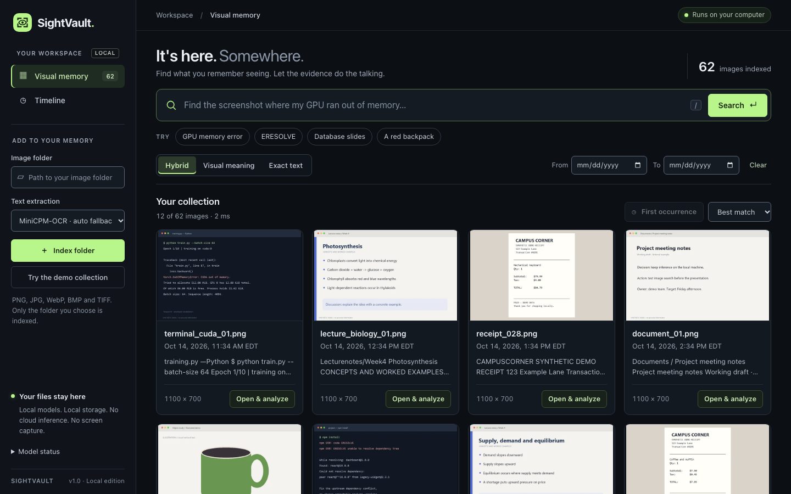

# SightVault

Find the screenshot you remember, even when you don't remember its filename.

SightVault indexes a folder of screenshots, slides, receipts or photos. Search by meaning or exact text, open the matching image, inspect its date and OCR, and ask a local vision model about the evidence.



## What you can do

- **Search visually:** find a GPU memory error, database lecture or red backpack from a description.
- **Find exact text:** look up error codes and phrases recovered by OCR.
- **Trace the source:** inspect the saved image, original path, file timestamp and extracted text.
- **Find the first match:** search the full index for the earliest matching file.
- **Analyze an image:** ask MiniCPM-V a question while keeping its answer attached to the source.

Inference runs locally. The app listens on loopback and scans only the folder you select. Images are embedded directly; search does not depend on generated captions.

## Run on a Mac

Tested on an **Apple M1 Pro with 16 GB unified memory**, using native Python 3.12. Install Python 3.12 or `uv` before setup. Dependency installation and model downloads require internet; inference uses local files afterward.

```bash
git clone https://github.com/DDDD-433/SightVault.git
cd SightVault/SightVault
bash Setup-Mac.sh
.venv/bin/python handoff/download_pinned_models.py
.venv/bin/python scripts/prepare_mac_models.py
bash Start-SightVault.command
```

Open **http://127.0.0.1:7861/** and index your image folder. A Git checkout starts with an empty local database; weights, environments and personal indexes are excluded from Git.

For the **prepared 62-image demo**, download `SightVault_Source_Demo.zip` from the [Mac preview release](https://github.com/DDDD-433/SightVault/releases/tag/v0.1.0-mac-preview). It includes the validated demo index and its original sample dates. Follow the [demo setup instructions](SightVault/README.md#prepared-demo).

## Local models

| Component | Purpose | Tested Mac runtime |
| --- | --- | --- |
| EmbeddingGemma 2 | Direct image/text embeddings, 768 dimensions | PyTorch MPS, FP32 |
| MiniCPM-OCR 1.0 | Text extraction | MLX Metal, mixed 4-bit/BF16 |
| MiniCPM-V 4.7 1B | On-demand image analysis | MLX Metal, mixed 4-bit/BF16 |
| RapidOCR | Bulk OCR and labeled fallback | Local ONNX Runtime |

MiniCPM conversion preserves higher precision for vision and sensitive layers. The 4-bit label applies to selected layers. Model revisions, checksums, precision choices and memory measurements are recorded in [Phase 2 model selection](SightVault/qa/FINAL_MODEL_SELECTION.md). MiniCPM remains the default; optional LFM3-VL and Omni use the same application/index. Their setup and limits are in the [application README](SightVault/README.md#optional-vision-backends).

## Verification

The Phase 2 integration passed **184 tests**, **17 retrieval cases**, **37 browser checks for each of MiniCPM and Omni**, **10 normal-CSP checks**, **29 UI hardening checks**, and real offline model/concurrency/recovery runs. One expected failure still tracks retained copies of older edited files. Claude Code's Opus 5.5 high and one Sonnet 5.5 xhigh reviewer contributed the scoped interface polish; Codex ran the real verification.

See the [unified QA report](SightVault/qa/FINAL_UNIFIED_QA.md), [model selection and memory matrix](SightVault/qa/FINAL_MODEL_SELECTION.md), and [UI before/after review](SightVault/qa/UI_UX_REVIEW.md). These are measured local results, not a hosted CI status. Portable Mac/Windows **source-and-setup bundles** exclude weights/environments. Windows native execution remains unvalidated; its validation harness and exact instructions are included.

## Work on the project

Application code, scripts and tests are under [`SightVault/`](SightVault/). See [CONTRIBUTING.md](CONTRIBUTING.md) for the development workflow and [DEMO.md](SightVault/DEMO.md) for the walkthrough.

File timestamps describe indexed files, not proven event history. Similarity is not a confidence percentage. OCR and vision-model answers can be wrong; the source image remains the evidence.
