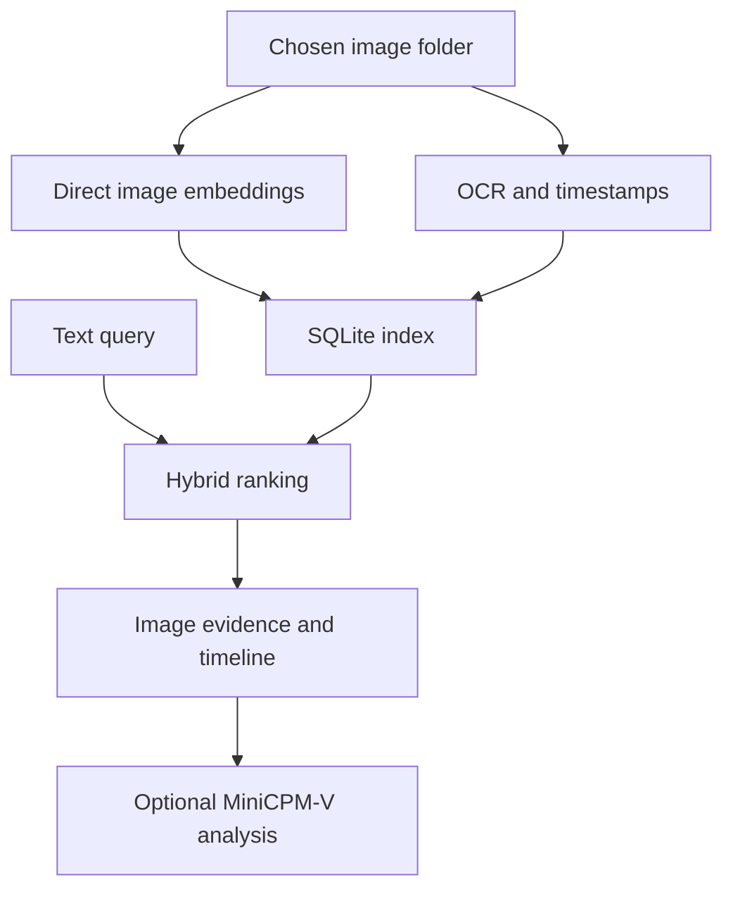

# SightVault

A private, fully local visual memory for your computer.

Index a folder of images, search by meaning or exact text, inspect the source, and ask a small vision model to explain it.

## Run on this PC

Double-click **Start-SightVault.cmd**, or open **http://127.0.0.1:7860** if the app is already running. The environment, three models and demo index have been prepared in this folder.

Enter an image folder and click **Index folder**. **Try the demo collection** indexes the included samples. Choose **RapidOCR** for faster bulk indexing, or leave **MiniCPM-OCR · auto fallback** selected for the preferred OCR model.

## Setup on another machine

Use Python 3.12 and allow about 15 GB free disk space for models and dependencies. NVIDIA CUDA is recommended; CPU inference is supported but slower. The source ZIP excludes the environment, downloaded weights and private index.

```powershell
python -m venv .venv
.venv\Scripts\python.exe -m pip install torch==2.11.0 torchvision==0.26.0 --index-url https://download.pytorch.org/whl/cu128
.venv\Scripts\python.exe -m pip install -r requirements.txt
.venv\Scripts\python.exe scripts/download_models.py
.venv\Scripts\python.exe app.py
```

On Linux/macOS use `.venv/bin/python`; install the appropriate PyTorch build for your hardware instead of the CUDA command. Model downloads and installation need internet. The running app loads local files only.

## Models and storage

| Component | Role |
| --- | --- |
| Google EmbeddingGemma 2 | Direct image and query embeddings, full 768 dimensions; audio encoder disabled |
| OpenBMB MiniCPM-OCR 1.0 | Text extraction; RapidOCR is an explicitly labeled local fallback |
| OpenBMB MiniCPM-V 4.7 1B | On-demand reasoning over a selected image |
| SQLite + FTS5 | Metadata, normalized vectors and full-text retrieval |

Images go directly to the embedding model. No caption generation is used for indexing. Hybrid ranking combines cosine similarity (0.70) and lexical coverage/FTS (0.30), with extra boosts for literal codes and OCR matches. **Visual meaning** uses only image/query embeddings; **Exact text** searches OCR and filenames.

The app preserves a local copy of each indexed image and thumbnail under `data/`. Re-indexing updates changed files; identical files reuse inference but retain their individual paths and timestamps. Only the selected folder is scanned. The service listens on loopback and has no cloud inference integration.



## Demo and verification

See **DEMO.md** for a two-minute walkthrough. There are 60 clearly marked synthetic screenshots, documents and object illustrations, plus two public sample images from Google's Gemma cookbook. `samples/photo_sources.json` records their sources. The benchmark manifest is never read by ingestion or retrieval.

```powershell
.venv\Scripts\python.exe scripts/make_demo.py
.venv\Scripts\python.exe scripts/index_folder.py samples --ocr rapid
.venv\Scripts\python.exe -m pytest tests -q
.venv\Scripts\python.exe scripts/benchmark.py --offline-check
.venv\Scripts\python.exe scripts/verify_offline.py
```

`make_demo.py` regenerates synthetic examples and restores their fictional dates. `benchmark.py` measures retrieval on the actual index. `verify_offline.py` blocks outbound socket connections before loading models, then performs semantic search, MiniCPM-OCR extraction and MiniCPM-V analysis. Results are saved as JSON.

## Limits and troubleshooting

- Supported inputs: PNG, JPG, WebP, BMP, TIFF. Export PDFs/slides to images first. Limits: 30 MB, 40 megapixels per image; 2,000 images per indexing run.
- File modified time is the default timestamp. EXIF capture dates are used only with an explicit timezone. Date filters use UTC; displayed timestamps use your browser's timezone. “First occurrence” means the earliest matching file in the index, not proven event history.
- OCR and model reasoning can make mistakes. Similarity scores are cosine values, not confidence percentages. All semantic searches return nearest candidates; an unrelated query may still have nearest images.
- First model use takes longer. Subsequent searches reuse loaded models. MiniCPM generative models share a slot to reduce GPU memory pressure; switching OCR/reasoning may reload weights.
- Windows uses PyTorch reference kernels for the small MiniCPM models. This is slower than optimized Linux kernels, but was tested on the RTX 4070.
- A missing embedding model leaves text search available. A missing VLM leaves search available. A failed preferred OCR model can fall back to RapidOCR in auto mode. Status and warnings identify the active path.
- If a file lacks an embedding, install the model and index its folder again. `--force` on the CLI refreshes existing inference. Set `SIGHTVAULT_DEVICE=cpu` for CPU-only execution.
- If port 7860 is busy, run `python app.py --port 7861` and open that URL. The double-click launcher uses 7860.
- The demo index was prepared with RapidOCR for speed. MiniCPM-OCR and MiniCPM-V were separately exercised on the CUDA example. The UI exposes the OCR backend on each evidence record.

Official model references: [EmbeddingGemma 2](https://huggingface.co/google/embeddinggemma-2), [MiniCPM-OCR](https://huggingface.co/openbmb/MiniCPM-OCR-1.0), [MiniCPM-V](https://huggingface.co/openbmb/MiniCPM-V-4.7-1B). Their model licenses apply to downloaded weights.

## QA notes (2026-10-29)
- Date filters use your local timezone.
- `Start-SightVault.cmd` waits up to 90 s, reports busy ports / startup errors (see `data\server.log`), and detects an already-running instance. Port: `SIGHTVAULT_PORT`.
- First search after launch loads the embedding model (~12 s); later searches are ~0.15 s.
- QA: `pytest tests`, `scripts\benchmark.py`, `scripts\qa_ingestion.py <workdir>`, `scripts\qa_browser.py <url> <shots>`. See QA_REPORT.md.
