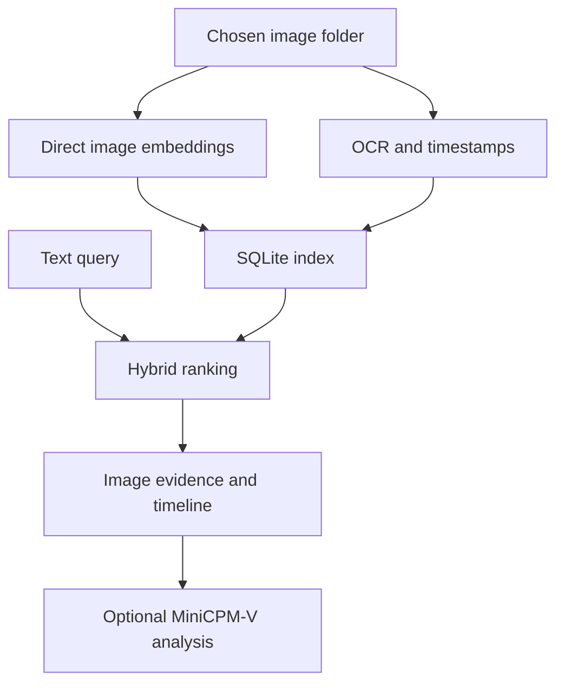

# SightVault

A private, fully local visual memory for your computer.

Index a folder of images, search by meaning or exact text, inspect the source, and ask a small vision model to explain it.

## Run on this Mac

Double-click **Start-SightVault.command** and open <http://127.0.0.1:7861/>. This extracted copy uses 7861 because another SightVault copy was already listening on 7860. Override with `SIGHTVAULT_PORT`. The launcher defaults to `SIGHTVAULT_DEVICE=auto`: direct EmbeddingGemma image/text inference uses PyTorch MPS in FP32, and MiniCPM OCR/analysis uses native MLX Metal with local mixed 4-bit weights. The generative models share one slot. CPU can be selected explicitly; it uses the original PyTorch weights.

## Reproduce setup

```bash
bash Setup-Mac.sh
.venv/bin/python handoff/download_pinned_models.py
.venv/bin/python scripts/prepare_mac_models.py
.venv/bin/python handoff/prepare_demo.py
.venv/bin/python handoff/prepare_demo.py --apply
bash Start-SightVault.command
```

Use native ARM Python 3.12; setup can locate/install it through `uv`. Dependencies are pinned in `requirements-mac.lock.txt`; original Windows requirements are retained. Downloads require internet; runtime inference reads local files only. The downloader verifies exact baseline revisions and checksums. The MLX converter uses those verified weights, records sources, versions, quantization and output checksums in each checkpoint's `source.json`, and preserves vision and sensitive components at higher precision. “4-bit” describes selected layers, not the complete checkpoint.

EmbeddingGemma stays FP32 because its activation range makes FP16 unsafe according to the model author. No unvalidated 8-bit embedding configuration is substituted. Direct image/text embeddings remain normalized 768-dimensional vectors, and the demo retains its existing vectors. See **MAC_QA_REPORT.md** for actual machine results, memory, tests and limitations. Windows evidence is historical under `handoff/history/windows-evidence/`.

Windows launch/setup files remain available for their original environment.

## Models and storage

| Component | Role |
| --- | --- |
| Google EmbeddingGemma 2 | Direct image and query embeddings, full 768 dimensions; audio encoder disabled |
| OpenBMB MiniCPM-OCR 1.0 | Text extraction; RapidOCR is an explicitly labeled local fallback |
| OpenBMB MiniCPM-V 4.7 1B | On-demand reasoning over a selected image |
| SQLite + FTS5 | Metadata, normalized vectors and full-text retrieval |

Images go directly to the embedding model. No caption generation is used for indexing. Hybrid ranking combines cosine similarity (0.70) and lexical coverage/FTS (0.30), with extra boosts for literal codes and OCR matches. **Visual meaning** uses only image/query embeddings; **Exact text** searches OCR and filenames.

The app preserves a local copy of each indexed image and thumbnail under `data/`. Re-indexing updates changed files; identical files reuse inference but retain their individual paths and timestamps. Only the selected folder is scanned. The service listens on loopback and has no cloud inference integration.



## Demo and verification

See **DEMO.md** for a two-minute walkthrough. There are 60 clearly marked synthetic screenshots, documents and object illustrations, plus two public sample images from Google's Gemma cookbook. `samples/photo_sources.json` records their sources. The benchmark manifest is never read by ingestion or retrieval.

```powershell
.venv\Scripts\python.exe scripts/make_demo.py
.venv\Scripts\python.exe scripts/index_folder.py samples --ocr rapid
.venv\Scripts\python.exe -m pytest tests -q
.venv\Scripts\python.exe scripts/benchmark.py --offline-check
.venv\Scripts\python.exe scripts/verify_offline.py
```

`make_demo.py` regenerates synthetic examples and restores their fictional dates. `benchmark.py` measures retrieval on the actual index. `verify_offline.py` blocks outbound socket connections before loading models, then performs semantic search, MiniCPM-OCR extraction and MiniCPM-V analysis. Results are saved as JSON.

## Limits and troubleshooting

- Supported inputs: PNG, JPG, WebP, BMP, TIFF. Export PDFs/slides to images first. Limits: 30 MB, 40 megapixels per image; 2,000 images per indexing run.
- File modified time is the default timestamp. EXIF capture dates are used only with an explicit timezone. UI date filters and displayed timestamps use your browser's timezone. Plain date-only API filters use UTC days. “First occurrence” means the earliest matching file in the index, not proven event history.
- OCR and model reasoning can make mistakes. Similarity scores are cosine values, not confidence percentages. All semantic searches return nearest candidates; an unrelated query may still have nearest images.
- First model use takes longer. Subsequent searches reuse loaded models. MiniCPM generative models share a slot to reduce GPU memory pressure; switching OCR/reasoning may reload weights.
- Windows uses PyTorch reference kernels for the small MiniCPM models. This is slower than optimized Linux kernels, but was tested on the RTX 4070.
- A missing embedding model leaves text search available. A missing VLM leaves search available. A failed preferred OCR model can fall back to RapidOCR in auto mode. Status and warnings identify the active path.
- If a file lacks an embedding, install the model and index its folder again. `--force` on the CLI refreshes existing inference. Set `SIGHTVAULT_DEVICE=cpu` for CPU-only execution.
- If port 7860 is busy, run `python app.py --port 7861` and open that URL. The Mac double-click launcher defaults to 7861.
- The demo index was prepared with RapidOCR for speed. MiniCPM-OCR and MiniCPM-V were separately exercised on the CUDA example. The UI exposes the OCR backend on each evidence record. Mac OCR and analysis measurements are recorded separately in MAC_QA_REPORT.md.

Official model references: [EmbeddingGemma 2](https://huggingface.co/google/embeddinggemma-2), [MiniCPM-OCR](https://huggingface.co/openbmb/MiniCPM-OCR-1.0), [MiniCPM-V](https://huggingface.co/openbmb/MiniCPM-V-4.7-1B). Their model licenses apply to downloaded weights.

## QA notes (2026-10-29)
- Date filters use your local timezone.
- `Start-SightVault.cmd` waits up to 90 s, reports busy ports / startup errors (see `data\server.log`), and detects an already-running instance. Port: `SIGHTVAULT_PORT`.
- First search after launch loads the embedding model (~12 s); later searches are ~0.15 s.
- QA: `pytest tests`, `scripts\benchmark.py`, `scripts\qa_ingestion.py <workdir>`, `scripts\qa_browser.py <url> <shots>`. See QA_REPORT.md.

Independent Claude QA: Opus 5.5 high and one Sonnet 5.5 xhigh worker completed a separate review. The integrated suite has 123 passing tests and one documented expected failure for retained superseded copies. See `qa/independent-review/FINAL_QA_REPORT.md`. Reindex repairs missing saved copies; processing transparent images composites onto white. EXIF capture timestamps are read from the standard sub-IFD only when a timezone offset is supplied. Existing rename-history and retained-copy behavior remain documented limitations.
