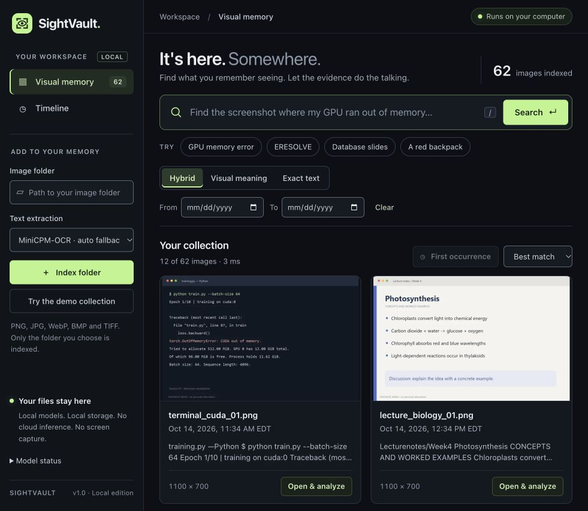
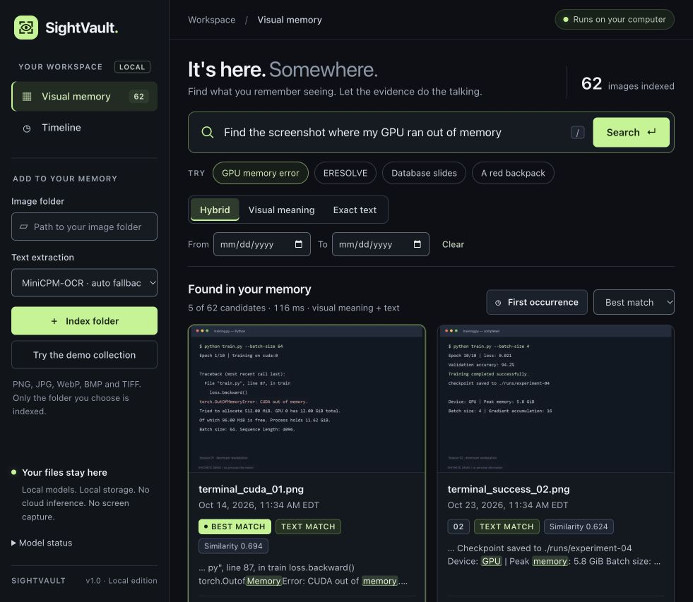
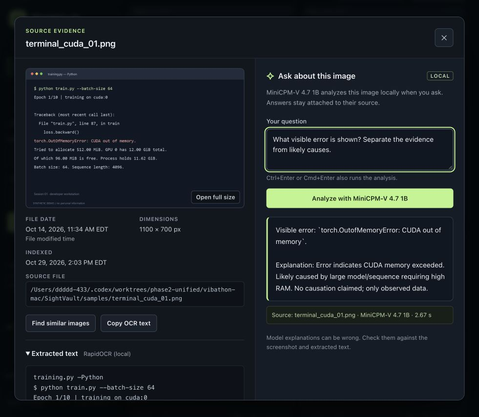

# SightVault interface review and polish

Claude Code implemented the scoped frontend pass with **claude-opus-5-5, high** and exactly one read-only **claude-sonnet-5-5, xhigh** reviewer. The actual selectors and reviewer effort were verified from CLI metadata. Coding used the user's existing subscription. Raw transcripts and account metadata remain outside the repository/package. [Claude's report](unified/CLAUDE_UI_REPORT.md) separates estimates and reading-only review from the real verification below.

The existing charcoal/lime product remains the visual target. No new framework, remote font/CDN, generated illustration, model identity, inference backend, search ranking or database schema was introduced by this UI pass.

1. **Collection — healthy.** The header is more compact; system typography, readable metadata, stronger controls and aligned card actions make the collection easier to scan. The narrow layout has reachable timeline navigation. The laptop sidebar was widened after visual review to prevent its navigation label wrapping.

   

2. **Search — healthy.** Image framing, contrast, text snippets and best/earliest badges are clearer. OCR snippets center on matching terms and escape each segment before adding highlights. The badge says **Text match**, since lexical matching includes filenames. Similarity remains a ranking signal, not confidence. A real rapid-entry race was fixed: Enter now submits the latest query even while a preceding mode request is pending, while respecting IME composition. The browser regression reproduces the pending state with network latency.

   

3. **Evidence and local analysis — healthy.** The dialog has an accessible name, labeled source metadata, selectable full path, focusable OCR, visible focus rings, in-dialog copy/validation feedback, loading/error states and source-attached answers. Cmd+Enter was exercised through the in-app browser with a real MiniCPM answer; the screenshot below is that actual output. The uncertainty note remains visible.

   

The parent inspected accepted before/after screenshots in the in-app browser, rejected loading/stale-asset captures, then tested the patched application. Reused-browser testing exposed old cached JS/CSS mixed with new markup; content-derived asset URLs now prevent that upgrade mismatch, and a regression checks those keys against served bytes. The portable source allowlist also now includes the real SVG favicon.

The complete default browser walkthrough passed 37 checks; normal-CSP edge checks passed 10. Supplemental UI hardening passed **29 checks** across 1440px, 390px, 320px and a 720-CSS-pixel/2x-DPR reflow proxy, reduced motion, literal malicious OCR/filenames, real missing-Omni-runtime errors, clipboard/validation feedback and search after failure. Escaping also passed a separate CSP-bypassed stress session, so CSP is not being mistaken for sanitization. These are current-run results, not Claude's unexecuted estimates.

The 720px/2x test is a 200%-equivalent reflow proxy; native browser zoom, a formal screen-reader review and full WCAG compliance are not claimed. CSS contrast estimates in Claude's report are not treated as measured certification. [Hardening results](unified/ui-hardening.json), [CSP results](unified/normal-csp-polished.json), [escaping results](unified/xss-escaping.json), [before captures/notes](unified/ui/AUDIT.md).
