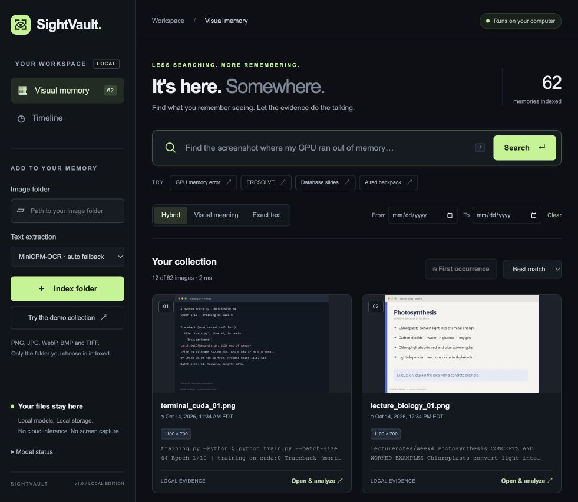
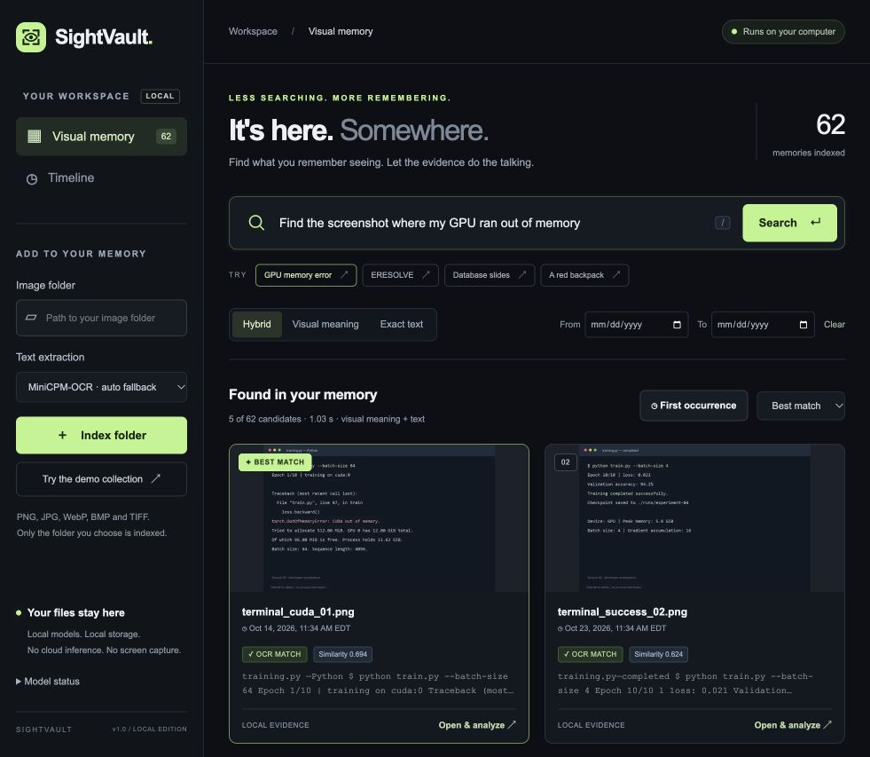
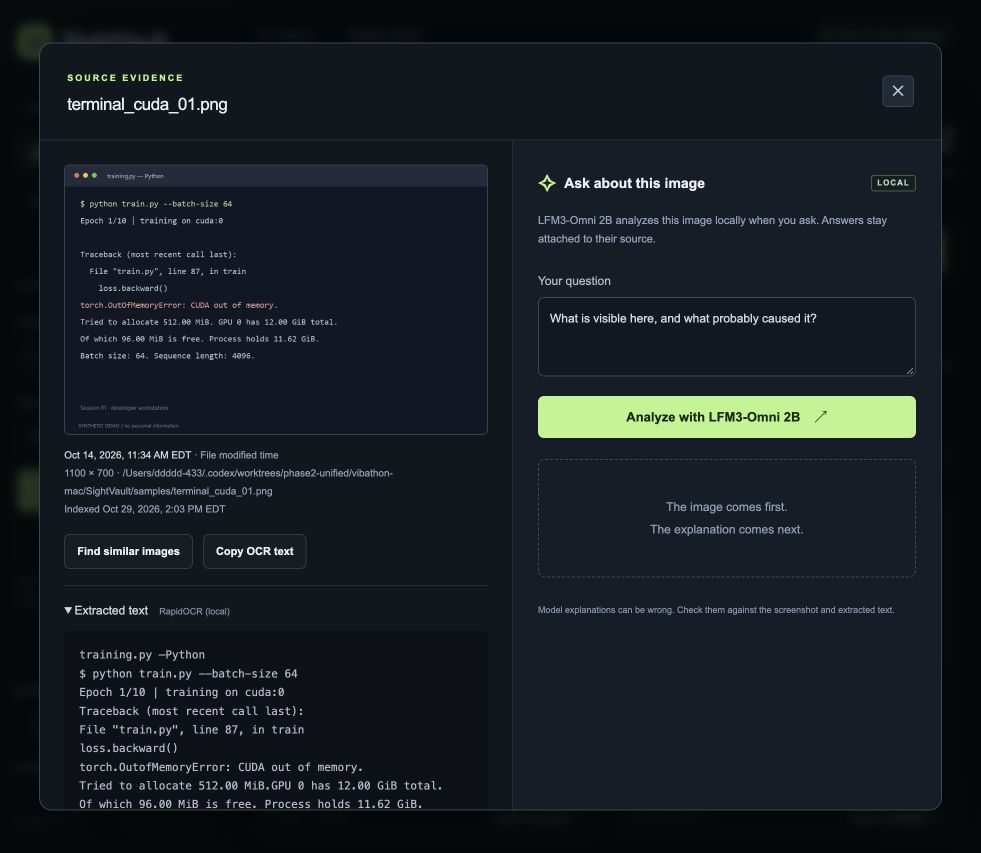

# SightVault UI/UX pass — captured October 31, 2026

Scope: collection → search → evidence/analysis entry in the real unified application, in-app browser. Existing brand and working interactions are the visual target. This audit is followed by the authorized Claude implementation; it is not a redesign proposal requiring a new visual direction.

1. **Collection — functional, hierarchy can improve.** Search is prominent and locality is clear. The tall hero/stacked controls push visual memories down on a laptop; fine-print metadata and secondary controls are hard to scan. Keep charcoal/lime and improve spacing, contrast and content density.

2. **Search — healthy behavior, crowded cards.** The real query returns the CUDA screenshot first and separates semantic similarity from OCR matching. Small monospace OCR excerpts and repeated footer chrome compete with image/title. Improve card typography and action affordances; keep ranking, evidence links and score semantics unchanged. A loading capture was rejected and replaced with the completed state shown here.

3. **Evidence — healthy source attachment, reading can improve.** Original image, timestamp, extracted text, model identity and an explicit question all remain visible. The full path wraps into several tiny lines, OCR/body text is cramped, and the empty answer panel is decorative. Improve the source/metadata/question/answer hierarchy and responsive reading without hiding provenance or making explanations look certain.

Accessibility limits: screenshots suggest secondary-text contrast and small target risks; they do not establish WCAG conformance. Keyboard, focus, reduced motion, zoom and live announcements require implementation checks and real browser tests. Parent QA covers keyboard/modal behavior and responsive reflow after the patch. Claude may change only the existing frontend files; all inference, retrieval, dates, escaping, identities and local-only boundaries stay intact.
